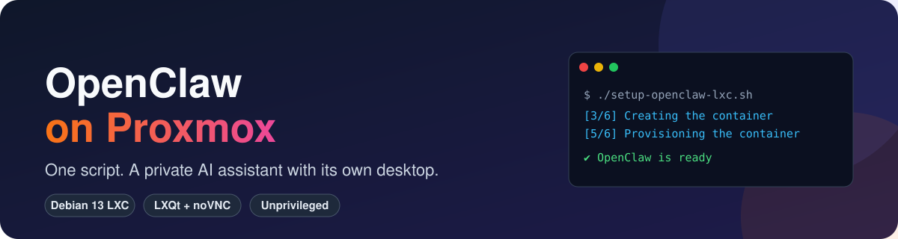
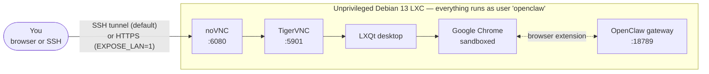

<div align="center">



<br>

[](https://github.com/yorch/openclaw-proxmox/actions/workflows/lint.yml)
[](LICENSE)

-a81d33?logo=debian&logoColor=white)


**[Website](https://yorch.github.io/openclaw-proxmox/)** ·
**[Quick start](#-quick-start)** ·
**[How it works](#-how-it-works)** ·
**[Configuration](#-configuration)** ·
**[Security](#-security-model)** ·
**[Operations](#-day-2-operations)** ·
**[Troubleshooting](#-troubleshooting)**

</div>

---

Run one command on your Proxmox host and get a ready-to-use **[OpenClaw](https://openclaw.ai/) AI assistant** living in its own container, with a full Linux desktop you can open from any browser. No packages to chase, no config files to edit.

|  |  |
|---|---|
| 🧱 **Contained** | Unprivileged LXC, everything runs as a regular user — never as root |
| 🔒 **Private by default** | Nothing is exposed to the network except SSH; opt in to Tailscale or an HTTPS desktop on your LAN |
| 🖥️ **A desktop for your agent** | LXQt + Google Chrome + noVNC, so the assistant has a real browser and you can watch it work |
| ⚙️ **Configurable** | Pick VMID, storage, bridge, static IP, VLAN, resources — interactively or from environment variables |
| 🛡️ **Fails loudly** | Strict error handling inside and outside the container; a failed run offers to clean up after itself |
| ♻️ **Survives reboots** | Container and services start with the host |

## 🚀 Quick start

On your **Proxmox host**, as root:

```bash
bash <(curl -fsSL https://raw.githubusercontent.com/yorch/openclaw-proxmox/main/setup-openclaw-lxc.sh)
```

You'll be asked for a password and a handful of options (all have sensible defaults), shown a plan, and asked to confirm before anything is created.

<details>
<summary><b>Prefer to read the script first?</b></summary>

It is a single file. Download it, review it, then run it:

```bash
git clone https://github.com/yorch/openclaw-proxmox.git
cd openclaw-proxmox
less setup-openclaw-lxc.sh
./setup-openclaw-lxc.sh
```

</details>

<details>
<summary><b>Unattended install</b></summary>

Every prompt can be preset with an environment variable, and `--yes` skips the confirmation:

```bash
CT_PASSWORD='change-me' DISK_SIZE=64 MEMORY=8192 \
IP_ADDRESS=10.20.0.50/24 GATEWAY=10.20.0.1 VLAN_TAG=20 \
./setup-openclaw-lxc.sh --yes
```

See [Configuration](#-configuration) for the full list.

</details>

**What you need:** Proxmox VE 9 (8.x may work, see below) on an **amd64** host, root access, and internet access. Debian 13 containers need a recent `pve-container` (6.0.10 or newer has been reported to work, and support on PVE 8 is unconfirmed); run `apt full-upgrade` on the host if `pct create` rejects the template.

## 🧭 How it works

The installer runs in six numbered stages and is safe to read top to bottom:

```text
 [1/6] Checking the host and collecting settings
 [2/6] Selecting storage and template        ← shows the plan, asks to confirm
 [3/6] Creating the container
 [4/6] Waiting for the network
 [5/6] Provisioning the container            ← one strict script, [1/14] … [14/14]
 [6/6] Verifying services                   ← service state plus HTTP/port probes
```

What ends up running inside the container:



The three long-running pieces are systemd services — `openclaw-gateway`, `vncserver` and `novnc` — and they start on boot together with the container.

### What you see when it finishes

An example summary (your values will differ):

```text
  ✔ OpenClaw is ready  (finished in 9m 42s)
  ━━━━━━━━━━━━━━━━━━━━━━━━━━━━━━━━━━━━━━━━━━━━━━━━━━━━━━━━━━━━
  Container        105 (openclaw) · 10.1.1.186
  SSH login        ssh openclaw@10.1.1.186   (no sudo; root shell: pct enter 105)   # or "sudo needs the password" with ENABLE_SUDO=1

  Remote desktop
  URL              http://localhost:6080/vnc.html
                   first run: ssh -L 6080:127.0.0.1:6080 -L 18789:127.0.0.1:18789 openclaw@10.1.1.186
  VNC password     Ab3dEf9h

  OpenClaw dashboard  (loopback only)
  URL              http://localhost:18789/   or the Dashboard shortcut on the desktop
  Auth token       3f2a…

  Next steps
    1. Open the remote desktop URL and sign in with the VNC password
    2. Double-click "OpenClaw Setup Wizard" to configure channels and skills
    3. Add the Chrome extension from the Chrome Web Store …
```

A private copy of this summary is saved on the Proxmox host as `/root/openclaw-lxc-<VMID>.txt` (readable by root only).

## 🖥️ Using it

By default the remote desktop and the dashboard listen on the container's **loopback only**. Open an SSH tunnel from your computer, then browse to them locally:

```bash
ssh -L 6080:127.0.0.1:6080 -L 18789:127.0.0.1:18789 openclaw@<container-ip>
```

| What | Where | Notes |
|---|---|---|
| Remote desktop | `http://localhost:6080/vnc.html` | Sign in with the generated VNC password |
| OpenClaw dashboard | `http://localhost:18789/` | Or use the desktop shortcut, which fills in the token |
| Shell | `ssh openclaw@<container-ip>` | Password, or your GitHub SSH keys with `GITHUB_SSH_USER`; root SSH is not enabled, use `pct enter <VMID>` for root |

Prefer direct access on a trusted network? Install with `EXPOSE_LAN=1` and the desktop is served at `https://<container-ip>:6080/vnc.html` (self-signed certificate, HTTPS only). The dashboard always stays on loopback, because OpenClaw's Control UI needs a secure context.

### Remote access with Tailscale (optional)

Answer yes to **Enable Tailscale** (or set `ENABLE_TAILSCALE=1`, or provide `TS_AUTHKEY`) and the container joins your tailnet and publishes both services over HTTPS with real certificates — no SSH tunnel, nothing on your LAN:

| What | Address |
|---|---|
| Dashboard | `https://<hostname>.<tailnet>.ts.net/` |
| Remote desktop | `https://<hostname>.<tailnet>.ts.net:8443/vnc.html` |

- **Login:** paste an auth key at the prompt (it is read silently and handed to the container through a private file), or leave it blank and open the login link the installer prints. Tagged, pre-approved, non-reusable keys are best.
- **Token still required:** the dashboard uses OpenClaw's own Tailscale Serve integration, and `gateway.auth.allowTailscale` is turned off, so being on your tailnet is not enough — the auth token is always needed.
- **Prerequisites:** MagicDNS and HTTPS certificates enabled on your tailnet, and Serve allowed. If they aren't, the installer says so and prints the command to re-run.
- **No `/dev/net/tun`?** The installer first tries to pass the TUN device through to the container. If that isn't possible it runs Tailscale in userspace networking mode: publishing works the same, but the container itself can't open connections to other tailnet devices.
- The `openclaw` user is made the Tailscale *operator* (required for OpenClaw-managed Serve), which means that user — and so the agent — can reconfigure Tailscale on this node.
- **First browser login needs approval:** because the token is mandatory and Tailscale identity is not trusted on its own, the first time a browser opens the tailnet dashboard OpenClaw asks to pair it. Approve it from the container: `openclaw devices list`, then `openclaw devices approve <requestId>`.
- **Key expiry:** in OpenClaw's Serve mode the gateway will not start while the node's Tailscale key is expired, which would also take down the loopback dashboard. Disable key expiry for this node in the Tailscale admin console. The way back is `openclaw config set gateway.tailscale.mode off` and a gateway restart.
- Tailscale Funnel (public internet) and Tailscale SSH are deliberately not set up.

**Desktop shortcuts**

| Shortcut | Does |
|---|---|
| OpenClaw Setup Wizard | Runs `openclaw onboard` (without installing a second gateway service) |
| OpenClaw Dashboard | Opens Chrome on the dashboard with your token already filled in |
| Google Chrome | The default browser |
| Terminal | lxterminal with a dark theme |

**First steps:** open the desktop → run the **Setup Wizard** → connect your channels and skills → add the **Chrome extension** from the [Chrome Web Store](https://chromewebstore.google.com/detail/kcdjddhmeafeomebliikmbpblkmkfoig) and check it with `openclaw browser extension status`.

## 🎛️ Configuration

Interactive prompts cover the essentials; everything below can also be preset as an environment variable (a preset value is never asked again).

<details open>
<summary><b>Container</b></summary>

| Variable | Default | Description |
|---|---|---|
| `CT_PASSWORD` | *(required)* | Password of the `openclaw` user (SSH login, and `sudo` when enabled) |
| `ENABLE_SUDO` | `0` | `1` lets `openclaw` use `sudo` (password required). Off by default because the agent runs as this user |
| `VMID` | next free | Container ID, checked against existing guests |
| `CT_HOSTNAME` | `openclaw` | Container hostname |
| `DISK_SIZE` | `32` | Root disk in GB |
| `MEMORY` | `4096` | RAM in MB |
| `CORES` | `4` | CPU cores |
| `SWAP` | `512` | Swap in MB |
| `ROOT_STORAGE` | menu (default `local-lvm`) | Storage for the root disk; the menu shows type and free space |
| `TMPL_STORAGE` | auto (`local`) | Storage for the Debian template |
| `TIMEZONE` | `host` | e.g. `Europe/Berlin`, or `host` to follow the Proxmox host |
| `ONBOOT` | `1` | Start the container when the host boots |
| `PRIVILEGED` | `0` | `1` creates a privileged container (not recommended) |

</details>

<details>
<summary><b>Network</b></summary>

| Variable | Default | Description |
|---|---|---|
| `BRIDGE` | menu (default `vmbr0`) | Bridge to attach to; the menu lists the bridges found on the host |
| `IP_ADDRESS` | `dhcp` | `dhcp`, or a static IPv4 address in CIDR form, e.g. `192.168.1.50/24` |
| `GATEWAY` | first host of the network | Required for a static address; must lie inside it |
| `NAMESERVER` | host resolver | DNS server(s), space separated |
| `SEARCHDOMAIN` | *(none)* | DNS search domain |
| `VLAN_TAG` | *(none)* | VLAN tag, 1–4094 |
| `MTU` | *(bridge default)* | MTU of the container NIC |

Static settings are validated (address form, gateway inside the network, DNS entries) and an address that already answers ping is refused. IPv4 and DHCP only; add IPv6 afterwards in the container's Network settings.

</details>

<details>
<summary><b>Access and desktop</b></summary>

| Variable | Default | Description |
|---|---|---|
| `EXPOSE_LAN` | `0` | `1` serves noVNC on the LAN over HTTPS; `0` keeps everything on loopback |
| `VNC_RES` | `1920x1080` | Remote desktop resolution |
| `GITHUB_SSH_USER` | *(none)* | GitHub username whose public SSH keys are authorized for `openclaw` (see below) |
| `SSH_DISABLE_PASSWORD` | `0` | `1` turns off SSH password login; only allowed together with `GITHUB_SSH_USER` |

**SSH keys from GitHub.** Give a GitHub username (at the prompt or as `GITHUB_SSH_USER`) and the installer downloads `https://github.com/<user>.keys` on the Proxmox host over HTTPS, keeps only lines that `ssh-keygen` accepts as public keys (at most 50), and installs them as `~openclaw/.ssh/authorized_keys`. Each key's type and SHA256 fingerprint is listed in the plan, so you can compare them with `ssh-keygen -lf ~/.ssh/id_ed25519.pub` before you confirm. Afterwards `ssh openclaw@<container-ip>` logs in with your key; password login stays on unless you answer yes to the follow-up question or set `SSH_DISABLE_PASSWORD=1`. Duplicate keys are collapsed, and `--yes` skips the username prompt (use `GITHUB_SSH_USER`). **If you disable password login** and the matching private key (or hardware token) is not on the machine you connect from, you are locked out of SSH: get in with `pct enter <VMID>`, delete `/etc/ssh/sshd_config.d/10-openclaw.conf` and run `systemctl reload ssh`. The keys are a snapshot taken at install time: adding or revoking keys on GitHub later does not change the container, so edit `authorized_keys` yourself. In an unattended run a failed import (unknown user, no keys, network error) stops the installer instead of silently continuing without keys.

</details>

<details>
<summary><b>Tailscale</b></summary>

| Variable | Default | Description |
|---|---|---|
| `ENABLE_TAILSCALE` | `0` | `1` installs Tailscale and publishes the dashboard and noVNC on your tailnet (implied when `TS_AUTHKEY` is set) |
| `TS_AUTHKEY` | *(prompted)* | Auth key for an unattended join; blank means "log in with a link". Pass it through the environment, never as an argument |
| `TS_HOSTNAME` | container hostname | Node name on the tailnet |

</details>

<details>
<summary><b>Software versions</b></summary>

| Variable | Default | Description |
|---|---|---|
| `OPENCLAW_VERSION` | `latest` | npm version of OpenClaw. Releases before 2026.9.3 have known security advisories; 2026.9+ needs Node 24 or newer |
| `NODE_MAJOR` | `24` | Node.js major version (OpenClaw currently needs ≥ 24.16 <25, or ≥ 26.1) |
| `HOMEBREW_INSTALL_REF` | `HEAD` | Git ref of the Homebrew installer to use |

</details>

**Command line:** `-y` / `--yes` skips the confirmation, `-h` / `--help` prints usage. Set `NO_COLOR=1` to disable colors.

**What gets installed** (all inside the container, nothing on the Proxmox host): Node.js from the signed NodeSource apt repository, OpenClaw, Homebrew (for OpenClaw skills), LXQt, TigerVNC, noVNC, Google Chrome, OpenSSH, and the Noto Color Emoji font.

## 🔒 Security model

| Layer | Choice |
|---|---|
| Container | **Unprivileged** with nesting; a container escape needs more than a root process inside it |
| Processes | Gateway, desktop and Chrome run as **`openclaw`**, not root; Chrome keeps its **sandbox** |
| Privileges | `openclaw` has **no general sudo** by default; administer with `pct enter <VMID>` from the host. The only exception is a narrow rule that lets it run `sudo systemctl restart openclaw-gateway` (nothing else, no password). `ENABLE_SUDO=1` adds it to the `sudo` group, and every other `sudo` then needs the user's password |
| Network | Only **SSH** is reachable by default; noVNC and the gateway are on loopback. With Tailscale they are published on your tailnet only (no Funnel) |
| SSH | Optional **key login** with your GitHub public keys (fetched over HTTPS, validated, fingerprints shown for confirmation); `SSH_DISABLE_PASSWORD=1` makes it key-only |
| Remote desktop | Optional **HTTPS-only** noVNC (`EXPOSE_LAN=1`) with a generated certificate and a random VNC password |
| Secrets | Passed to the container through private files (including any Tailscale auth key), never on command lines; the files are removed afterwards |
| Supply chain | Node.js from a signed apt repository (no piped installers); versions can be pinned |

What this does **not** do: the AI agent can still run commands as `openclaw` and browse the web for you, and VNC passwords are limited to 8 characters by the protocol. Treat the container like a machine you gave an intern: put it on a network segment you are comfortable with and keep the desktop on loopback unless you need otherwise.

## 🧰 Day-2 operations

```bash
pct enter <VMID>                       # root shell in the container
pct stop <VMID> && pct start <VMID>    # restart it
pct snapshot <VMID> before-upgrade     # snapshot before risky changes
pct exec <VMID> -- systemctl status openclaw-gateway vncserver novnc
```

**Restart the gateway** after changing its config: inside the container as `openclaw`, run `sudo systemctl restart openclaw-gateway` (a narrow, passwordless rule allows exactly that); from the host, `pct exec <VMID> -- systemctl restart openclaw-gateway`.

**Containers installed before this rule existed** can get it with one command on the Proxmox host:

```bash
pct exec <VMID> -- bash -c 'S=$(readlink -f "$(command -v systemctl)"); echo "openclaw ALL=(root) NOPASSWD: $S restart openclaw-gateway, $S restart openclaw-gateway.service" > /etc/sudoers.d/openclaw-gateway && chmod 440 /etc/sudoers.d/openclaw-gateway && visudo -cf /etc/sudoers.d/openclaw-gateway'
```

**Update OpenClaw** (inside the container, as root, e.g. `pct enter <VMID>`): `npm install -g openclaw@latest`, then restart the gateway. Check the [Node requirement](#-configuration) when jumping versions.

**Start over / remove**: `pct stop <VMID>; pct destroy <VMID> --purge`. This deletes the container and its disk.

## 🩺 Troubleshooting

<details>
<summary><b>The setup failed halfway</b></summary>

The script keeps the half-built container for inspection and offers to destroy it. To clean up by hand: `pct stop <VMID>; pct destroy <VMID> --purge`. The output of the failing command is shown right before the error.

</details>

<details>
<summary><b><code>pct create</code> rejects the Debian 13 template</b></summary>

Your `pve-container` package is too old for Debian 13. Update the host (`apt update && apt full-upgrade`) and run the installer again.

</details>

<details>
<summary><b>Tailscale did not come up</b></summary>

- **Login link timed out:** finish it inside the container: `tailscale up --hostname=<name> --accept-dns=false --operator=openclaw`, then publish noVNC with `tailscale serve --bg --https=8443 http://127.0.0.1:6080` (use `https+insecure://127.0.0.1:6080` if you installed with `EXPOSE_LAN=1`). To have OpenClaw publish the dashboard, run as `openclaw`: `openclaw config set gateway.tailscale.mode serve` and `openclaw config set gateway.auth.allowTailscale false`, then `systemctl restart openclaw-gateway`.
- **`tailscale serve` failed:** enable HTTPS certificates and Serve for your tailnet in the Tailscale admin console (DNS / settings), then re-run the command above.
- **Userspace mode:** check `pct config <VMID>` for a `dev0: /dev/net/tun` line. Without it the installer uses userspace networking (publishing works; outbound tailnet connections don't).

</details>

<details>
<summary><b>A service is not running</b></summary>

```bash
pct exec <VMID> -- systemctl status openclaw-gateway
pct exec <VMID> -- journalctl -u openclaw-gateway -n 50 --no-pager
```

Replace `openclaw-gateway` with `vncserver` or `novnc` as needed.

</details>

<details>
<summary><b>Chrome does not start (sandbox error)</b></summary>

Chrome's sandbox needs user namespaces inside the container. As a last resort, run `echo --no-sandbox > /etc/openclaw/chrome-flags` as root in the container. This weakens isolation, so prefer fixing the namespace support first.

</details>

<details>
<summary><b>The Chrome extension is missing</b></summary>

The installer registers OpenClaw's native messaging host and reports it in the summary. The extension itself cannot be installed unattended on Linux: add it from the [Chrome Web Store](https://chromewebstore.google.com/detail/kcdjddhmeafeomebliikmbpblkmkfoig), then restart Chrome once if it was already open. Check the state with `openclaw browser extension status` (the `chrome` registration should be `owned`). The log of the registration is in `~/openclaw-extension.txt` in the container. For development you can instead load the unpacked copy from `~/.openclaw/browser/chrome-extension` at `chrome://extensions`. If registration failed, start Chrome once and run `openclaw browser extension install` as `openclaw`.

</details>

<details>
<summary><b>The onboarding wizard shows warnings</b></summary>

The gateway already runs as a system service, so the wizard shortcut starts `openclaw onboard --skip-daemon`. If you run the wizard yourself, decline prompts to install a daemon or to change the gateway's bind address or token — the services and the dashboard shortcut depend on the values the installer wrote. A "Gateway service install failed" message is therefore expected and safe to ignore. If you see a `ws://` security warning, the gateway has been moved off loopback; use the SSH tunnel instead.

</details>

## ❓ FAQ

**Why unprivileged, and why not run as root?** An AI agent that executes commands and drives a browser is exactly the thing you want boxed in. Unprivileged containers plus a normal user mean a compromised agent or browser does not get root, in the container or on the host.

**Why isn't the desktop on my LAN by default?** VNC is a weak protocol (8-character passwords). Loopback plus an SSH tunnel is the safest default; `EXPOSE_LAN=1` is there when you trust your network.

**Can I run it on ARM?** Not yet — Google Chrome is installed from its amd64 package, so the installer stops early on other architectures.

**Can I re-run it?** Each run creates a new container; it does not modify existing ones. Use a snapshot or `pct destroy` to roll back.

## 🤝 Contributing

Issues and pull requests are welcome. The project is a single Bash script; [CLAUDE.md](CLAUDE.md) explains its architecture and conventions.

- Run `shellcheck setup-openclaw-lxc.sh` and `bash -n setup-openclaw-lxc.sh` before opening a PR; CI also lints the embedded in-container script.
- There is no automated test suite — try changes on a Proxmox host.
- Use [Conventional Commits](https://www.conventionalcommits.org/) (`fix:`, `feat:`, `docs:`, …).

## 📜 Credits and license

Forked from [adadrag/Openclaw-Proxmox](https://github.com/adadrag/Openclaw-Proxmox) and substantially reworked. Released under the [MIT License](LICENSE).
